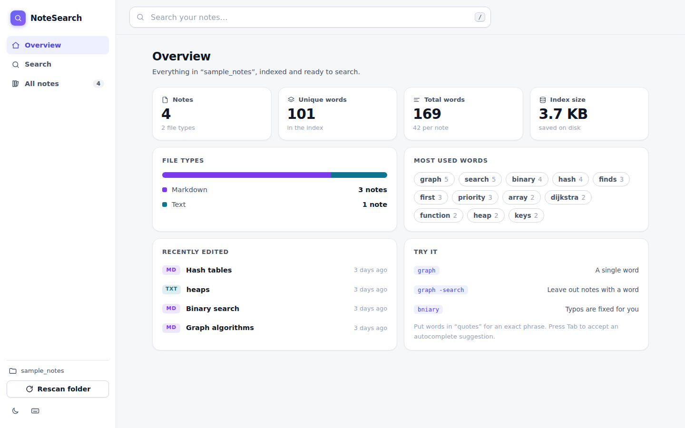
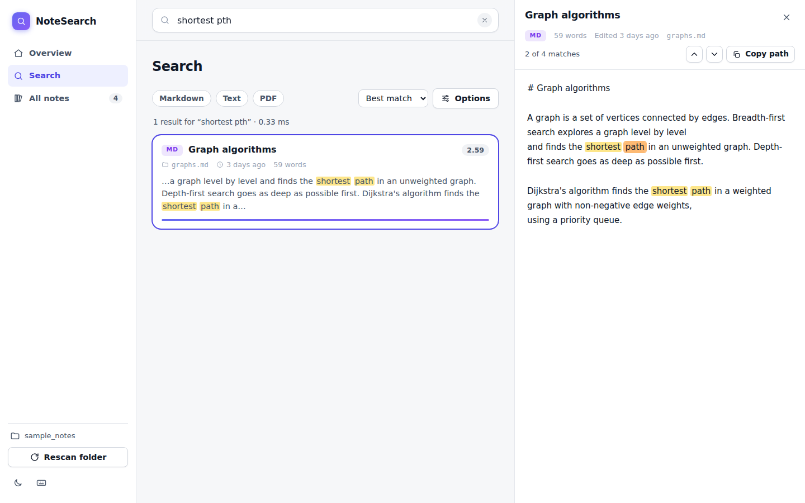
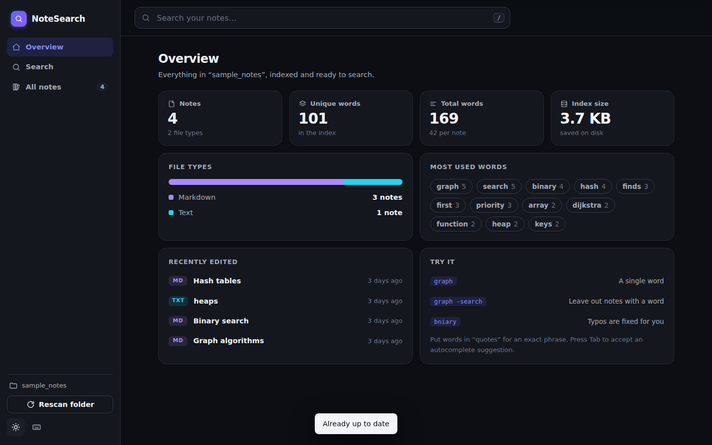

# notesearch

Search your own `.txt`, `.md` and `.pdf` notes from the terminal or a browser.
Built to practise data structures and algorithms: inverted index, trie, BK-tree, heap and BM25.

## Quick start

```bash
pip install -r requirements.txt
```

Point it at a notes folder (`-d`, or set `NOTESEARCH_DIR`):

| Windows PowerShell | macOS / Linux |
|---|---|
| `$env:NOTESEARCH_DIR = "C:\Users\you\Documents\notes"` | `export NOTESEARCH_DIR=~/notes` |

```bash
python -m notesearch -d sample_notes index          # first scan; later scans only touch changed files
python -m notesearch -d sample_notes search "binary serch"
python -m notesearch -d sample_notes search "\"priority queue\" -dijkstra"
python -m notesearch -d sample_notes suggest "hea"
python -m notesearch -d sample_notes watch          # keep the index fresh
python -m notesearch -d sample_notes serve          # web app at http://127.0.0.1:8000
```

Quote the whole query in the shell when it contains `-word`.

## Web app

`serve` starts a single-page app. It is plain HTML, CSS and JavaScript (ES modules): no build step, no npm, no external libraries or fonts.




| View | What it does |
|---|---|
| **Overview** | Stats cards, file-type breakdown, most used words, recently edited notes, clickable search examples |
| **Search** | Search as you type with autocomplete, file-type filters, sort, options (fix typos, match any word, result count), highlighted snippets with a relevance bar |
| **All notes** | Sortable, filterable table of every indexed note |
| **Note reader** | Docked panel (drawer on small screens) with the whole note, every match highlighted, next/previous match, copy path |

Also: dark mode (follows the system, remembers your choice), phone layout with bottom navigation, skeleton loading states, toast messages, keyboard shortcuts (press `?`), and deep links: every search, filter and open note lives in the URL (`#/search?q=graph&types=md&note=graphs.md`) so the Back button and bookmarks work.



### Frontend structure

```
notesearch/web/
|-- index.html          page shell (sidebar, search box, reader, dialogs)
|-- favicon.svg
|-- css/style.css       design tokens (light/dark), layout, components
`-- js/
    |-- app.js          boot, routing, global search box, shortcuts
    |-- router.js       hash router (URL is the single source of truth)
    |-- api.js          fetch wrapper for the JSON API
    |-- utils.js        DOM helpers, icons, formatting, storage, toasts, theme
    |-- overview.js  search.js  library.js     the three views
    `-- reader.js       the note reader panel
```

JSON API: `GET /api/search` (`q, k, fuzzy, any, prefix, types, sort`), `/api/suggest`, `/api/doc`, `/api/notes`, `/api/overview`, `/api/stats`, `POST /api/reindex`.

Security notes: note text is HTML-escaped on the server before highlight tags are added; `/api/doc` only serves notes that are in the index (no file paths are read from the request); the server listens on 127.0.0.1 only.

## Tests

```bash
pip install pytest
python -m pytest -q        # 27 tests
```

## Where the DSA lives

| Feature | Structure / algorithm | File |
|---|---|---|
| Find notes by word | Inverted index: `term -> {doc: [positions]}` | `index.py` |
| Multi-word (AND) search | Set intersection | `index.py` |
| `"exact phrase"` | Position lists checked at p, p+1, p+2 ... | `index.py` |
| `-exclude` | Set difference | `index.py` |
| Ranking | BM25 (tf, idf, length normalisation) + title/phrase boosts | `index.py` |
| Top-k results | Heap (`heapq.nlargest`), O(n log k) | `index.py` |
| Typos | BK-tree over Levenshtein distance | `bktree.py` |
| Autocomplete | Trie + DFS + top-k by frequency | `trie.py` |
| Highlighting | Token char offsets mapped into a snippet window | `highlight.py` |
| Re-index only what changed | mtime + size check, set difference for deletions | `notebook.py` |
| Safe saves | Write temp file, then atomic `os.replace` | `notebook.py` |

## Known trade-offs

- The index is saved with pickle: only load index files you created.
- Swapped letters cost 2 edits, so short words allow fewer typos (<= 4 letters: 1 edit, longer: 2).
- The whole index lives in memory (fine for thousands of notes).
- The web server listens on 127.0.0.1 only; do not expose it to a network without adding authentication.
